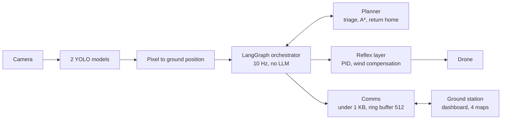

# SKYFORGE

**An autonomous recon and medical-support drone, fully simulated in 3D.**
Built for the IEEE AESS/RAS ENSIT Dronathon 3.0 (Tunis, 07–08 Nov 2026).


With zero human input, SKYFORGE flies over a coastal zone, maps hazards, ranks injured people by medical urgency,
drops simulated medical kits, keeps working through radio cuts, and returns home on its own.

> [!IMPORTANT]
> **Safety by design:** no weapon or dangerous payload. Triage uses medical urgency only.
> Hostile units are zones to avoid, never targets. No LLM call runs in the real-time loop.

## Results at a glance

From one full Webots mission on 8 Nov 2026, on the development PC. This is a single run, not a repeated series.

| Check | Target | Measured |
|---|---|---|
| Mission finished with no human input | Yes | **Landed after 756.5 s** |
| Medical kits delivered | — | **3 of 3** |
| Closest pass to an obstacle | Above 0 m (planner keeps ≥ 1 m) | **3.11 m** |
| Closest pass to a danger zone | Above 0 m (planner aims for 5 m) | **3.05 m** |
| Decision time, p95 | ≤ 100 ms | **29.0 ms** |
| Reflex compute time, p95 | < 50 ms | **0.047 ms** |
| Vision time, p95 | — | **50.0 ms** |
| Total loop, p95 | ≤ 150 ms | Not yet measured end to end |
| Injured people confirmed by vision | — | **4 of 5** |
| Other objects confirmed by vision | — | **0 of 20**, with 117 false positives (using early `main` weights) |

76 automated tests cover, among other things, a 30 s radio cut with full resync, a `goal_update` arriving exactly once,
earlier return in a headwind, and keeping 1 m from a moving obstacle.

## How it works



**Mission phases:** `INIT → EXPLORER → DÉTECTER → TRIAGE → NAVIGUER → LIVRER → (TRIAGE | RETOUR BASE) → POSÉ`

Three interrupts are checked every cycle:

| Trigger | Response |
|---|---|
| Battery at or under the return threshold | Forced `RETOUR BASE` |
| Radio link lost | Keep flying autonomously and buffer messages |
| `goal_update` received | Reroute immediately |

### The rules behind the decisions

| Rule | Formula |
|---|---|
| Triage score | `0.8 × priority/10 + 0.2 × proximity` (0 if the battery can't cover go + drop + return + reserve) |
| Return threshold, recomputed every cycle | `energy home (with wind) × 1.2 + 30 s landing + 10 % reserve` |
| Obstacle keep-out | `radius + 0.3 m drone half-span + 1 m gap + obstacle speed × 1 s` |
| Danger-zone keep-out | `radius + 5 m` |

Every triage decision is written to `mission_logs` with its reason.

## Quick start

### Run the 2D mission and maps (no GPU or Webots needed)

With Docker:

```bash
docker compose up
```

Or with Python 3.12 on Windows:

```bash
py -3.12 -m venv .venv
.venv/Scripts/python -m pip install -r requirements.txt
.venv/Scripts/python -m ground.demo
```

Then open http://localhost:8000.

### Run the 3D mission

1. Install [Webots R2025a](https://cyberbotics.com/) and create the `.venv` above.
2. Set your own Python path in `sim/webots/controllers/skyforge/runtime.ini`.
3. Datasets and weights aren't in this repo, so choose one:
   - **Without vision models:** set `SKYFORGE_PERCEPTION=oracle` before starting Webots.
   - **With YOLO:** install `torch`, `ultralytics` and `opencv-python`, then rebuild the data and train (below).
4. Open `sim/webots/worlds/skyforge.wbt` and press Run. The [Webots guide](sim/webots/README.md) explains the scene.

### Other commands

| Goal | Command |
|---|---|
| Dashboard + maps on Windows | `run_all.bat` (port 8077) |
| Tests | `.venv/Scripts/python -m pytest tests -q` |
| Rebuild datasets | See [DB/README.md](DB/README.md) |
| Train the models | `.venv/Scripts/python vision/train.py main`, or `people` |

## Vision models

Both are YOLO11n at 640 px, with a 70/20/10 split and drone-style augmentation on the training images only.

| Model | Classes | Images (train / val / test) | Status | Score |
|---|---|---|---|---|
| `people` | injured, healthy | 1433 / 396 / 208 | Trained, 60 epochs | Test mAP50 **0.782**, injured recall **0.705** |
| `main` | mine, weapon, litter | 8499 / 2445 / 1224 | **Training, epoch 18 of 40 on 8 Nov** | Interim validation mAP50 **0.753**, not a final test score |

The spec's target for `main` is accuracy above 90 %, with recall first for mines and weapons.

## Current limitations

- **Simulation vision:** the models were trained on real photos, so simulated people are often read as `healthy`.
- **Obstacles and danger zones:** in Webots these come from the scene data, not from a sensor. No LiDAR flies in the simulation.
- **Triage order:** triage only knows the casualties found so far, so a lower-priority person can be served first.
- **Radio resilience:** resync and `goal_update` run in the 2D mission and tests. Webots only logs link loss.
- **Hostile units:** these are known zones from the scene. There is no hostile vision class yet.
- **Casualty severity:** this comes from the scenario in Webots, because thermal and depth aren't simulated.
- **Packaging:** Docker covers the decision stack, 2D mission and maps. ROS2 isn't done, and Webots runs on the host.

## Real-drone concept

Not built or flown. These are calculated figures from typical datasheet values, and the competition mission is simulated.

| | |
|---|---|
| All-up weight | 1.80 kg without a kit |
| Thrust-to-weight | 2.89 |
| Estimated mission time | ≈ 37 min |
| Airframe | 550 mm carbon frame, 3508 700 KV motors, 13" propellers |
| Battery | Li-ion 4S3P, Molicel P45B, 194 Wh |
| Compute | Matek H743-SLIM + Raspberry Pi 5 with Hailo-8L |
| Sensors | Camera Module 3 Wide, 2 × TFmini-S LiDAR, IMU, barometer, GPS + compass |

The parts list and reasoning are in [HARDWARE_COMP.md](HARDWARE_COMP.md). CAD files are in [Hardware/](Hardware/).

## Project layout

| Folder | Contents |
|---|---|
| [`drone/`](drone/) | Shared state, LangGraph orchestrator, planner, return-to-home, onboard store |
| [`vision/`](vision/) | Data preparation, training, onboard detection, geolocation, casualty assessment |
| [`comms/`](comms/) | JSON protocol, ring buffer, resync |
| [`ground/`](ground/), [`UI UX/`](<UI UX/>) | Ground station, detection maps, dashboard |
| [`sim/`](sim/) | Shared scenario, 2D simulator, Webots world and controller |
| [`Hardware/`](Hardware/) | CAD files for the real-drone concept |
| [`tests/`](tests/) | Automated tests |

Spec digest: [MESSIONS_POINTS.md](MESSIONS_POINTS.md) · Progress: [TODO.md](TODO.md)
