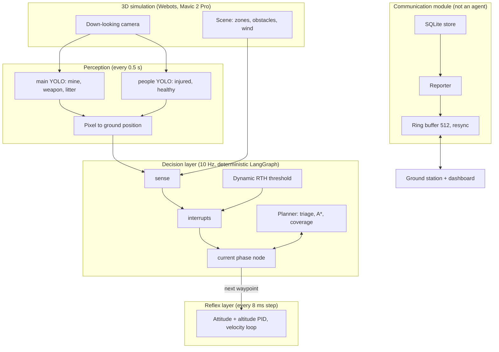
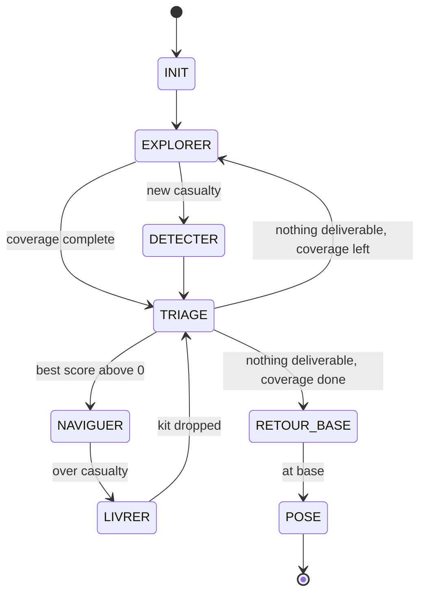

# SKYFORGE — Technical documentation

Autonomous recon and medical-support drone, fully simulated in 3D, for IEEE AESS/RAS ENSIT Dronathon 3.0.
With zero human input it explores a coastal zone, maps hazards, ranks injured people by medical urgency,
drops simulated medical kits, keeps working through radio cuts and returns to base.

**Safety rules built into the design:** no weapon or dangerous payload. Triage uses medical urgency only.
Hostile units are zones to avoid, never targets. No LLM call runs in the real-time loop.

Results below come from one Webots run and one 2D run (see [§8](#8-measured-results)), not from a repeated series.
[§9](#9-known-limitations) lists what is not finished yet.

## 1. Architecture

| Block | Code | Role |
|---|---|---|
| Shared state | `drone/state.py` | `DroneState`: position, velocity, battery, link, weather, zones, casualties, kits, goal, waypoints, phase, `mission_logs` |
| Orchestrator | `drone/orchestrator.py` | LangGraph graph run once per cycle |
| Planner | `drone/planner.py` | Energy model, A*, triage, lawn-mower coverage |
| Return to home | `drone/rth.py` | Threshold recomputed every cycle |
| Reflex + Webots loop | `sim/webots/controllers/skyforge/skyforge.py` | PID flight, wind force, moving obstacle, kit drop, latency measurement |
| Perception | `vision/onboard.py`, `vision/geolocate.py` | Runs both models and converts boxes to ground positions |
| Casualty assessment | `vision/casualty.py`, `vision/realtime.py` | Thermal + depth + motion to status, injury level and priority (not simulated in Webots) |
| Communication | `comms/link.py`, `comms/compact.py`, `comms/schema.py` | JSON messages, ring buffer, resync, `goal_update` retry and ack |
| Onboard reporting | `drone/store.py`, `drone/reporter.py` | Merges repeated sightings within 3 m, sends compact reports |
| Ground station | `ground/receiver.py`, `ground/server.py`, `ground/web/`, `UI UX/` | Stores reports, serves 4 synced detection maps and the dashboard |
| Simulators | `sim/kinematic.py`, `sim/scenario.py`, `sim/webots/make_world.py` | 2D mission sim and the shared scenario that generates the Webots world |

## 2. State machine

Every cycle runs `sense -> interrupts -> current phase`. Interrupts are checked in this order:

1. **Battery at or under the RTH threshold:** forced `RETOUR_BASE`. This overrides everything, including `goal_update`.
2. **Radio link lost:** logged, and the mission continues autonomously while messages are buffered.
3. **`goal_update` received:** reroute through `NAVIGUER`, then resume exploring.

## 3. Decisions

**Triage** (`drone/planner.py:130`): `score = 0.8 * priority/10 + 0.2 * proximity`.
The score is 0 if the casualty is already served, possibly deceased or unreachable, if no kit is left, or if the
battery cannot cover go + 20 s drop + return + reserve. Every result is written to `mission_logs` with its reason.

**Return to home** (`drone/rth.py`): `threshold = energy(A* path home, wind) x 1.20 + 30 s landing + 10 % reserve`.

**Energy model:** 59.3 Wh battery (Mavic 2 Pro), 100 W hover, plus 0.5 W per (m/s)² of airspeed.
Headwind therefore raises both the path cost and the RTH threshold.

**Path planning:** A* on a grid around inflated zones.

| Hazard | Distance kept |
|---|---|
| Mine, weapon, hostile unit | Zone radius + 5 m |
| Physical obstacle | Radius + 1 m gap + 0.3 m drone half-span |
| Moving obstacle | As above, plus the distance it covers in 1 s; replan or evade if the path is blocked |
| Radio shadow | Not an obstacle; the drone may fly through it |

**Coverage:** lawn-mower lanes. In Webots the lanes are spaced at 85 % of the camera footprint (23.3 m).

## 4. Reflex layer

Runs on every 8 ms Webots step. It combines the Mavic sample attitude PID,
altitude PD and a horizontal velocity loop toward the current waypoint. The velocity loop absorbs the wind force, which
provides the wind compensation.

## 5. Communication

| Item | Value |
|---|---|
| Format | Compact JSON with `version` (2), `seq`, `ts`, `type` |
| Size limit | Rejected at 1024 bytes or more; reports are packed to at most 1000 bytes |
| Largest message in the 2D run | 98 bytes (342 messages) |
| **Ring buffer capacity** | **512 messages**, more than 100 s even at 5 Hz (the reporter's telemetry default is 1 Hz) |
| After a cut | Ground spots `seq` gaps and sends `resync {from, to}`; the drone re-sends from the buffer |
| `goal_update` | Re-sent every second until acked; applied once, duplicates ignored |

The drone sends only new or changed objects, using an on-board SQLite store that merges repeated sightings. Each report
is acked, and one pushed out of the buffer before its ack is sent again. The ground station is our own mock
(`comms/link.py: GroundStation`), so it can be adapted when the jury's interface is known.

## 6. Vision

Both models are YOLO11n. Data is split 70/20/10, and augmentation imitates drone conditions (altitude, rotation, blur,
haze, glare, noise, compression) on the training split only. See `DB/README.md` for sources and class choices.

| Model | Classes | Status | Test set |
|---|---|---|---|
| `people.pt` | injured, healthy | Trained, 60 epochs | mAP50 0.782, injured recall 0.705, injured mAP50 0.80 |
| `main` | mine, weapon, litter | **Training in progress, target 40 epochs** | Not evaluated yet; best validation mAP50 so far 0.493 (epoch 1) |

Evaluate per class with `vision/train.py`, which reports on the test split once training ends.

## 7. Run it

Setup: Python 3.12 venv in `.venv`, with `requirements.txt` plus torch, ultralytics and opencv-python for vision.

| Goal | Command |
|---|---|
| 3D mission | Open `sim/webots/worlds/skyforge.wbt` in Webots R2025a and press Run. See `sim/webots/README.md` |
| 2D mission + maps | `.venv/Scripts/python -m ground.demo`, then open http://localhost:8000 |
| Dashboard + maps | `run_all.bat` (uses port 8077) |
| Docker | `docker compose up`, then open http://localhost:8000 |
| Tests | `.venv/Scripts/python -m pytest tests -q` |
| Train | `.venv/Scripts/python vision/train.py main`, add `resume` to continue a stopped run |

Webots results go to `runs/webots/summary.json` and `runs/webots/mission_logs.jsonl`.

## 8. Measured results

All from 8 Nov 2026. The Webots run used early `main` weights (epoch 1), so its detection figures will change.

| Check | Target | 3D Webots run | 2D run |
|---|---|---|---|
| Mission ends in `POSE` with no human input | Yes | Yes (756.5 s) | Yes (251 s simulated) |
| Kits delivered | — | 3 of 3 | 3 of 3 |
| Battery left | Above reserve | 61.6 % | 50.8 Wh (86 %) |
| Reflex p95 | < 50 ms | 0.047 ms | Not applicable |
| Decision p95 | ≤ 100 ms | 29.0 ms | 26.9 ms |
| Vision p95 | — | 50.0 ms | Not applicable |
| Closest approach to a danger zone | Above 0 m | 3.05 m | 5.01 m |
| Closest approach to an obstacle | Above 0 m | 3.11 m | No obstacles in this scenario |
| Injured confirmed by YOLO | — | 4 of 5 | Oracle perception |
| Scene objects confirmed by YOLO | — | **0 of 20** | Oracle perception |
| False positives | — | **117** | Oracle perception |

**Total loop (≤ 150 ms):** not measured as one figure. Adding the three p95 values gives about 79 ms, which is only an indication.

**Automated tests:** 76 pass, including a 30 s radio cut with full resync, `goal_update` during an outage arriving exactly once,
earlier RTH with headwind, low-battery return, and 1 m clearance with a moving obstacle.

## 9. Known limitations

| Area | Current behaviour | Effect |
|---|---|---|
| Kit allocation | Triage runs as casualties are found, using only those known so far. Both runs served casualties 1, 5, 2: priority 3 was served before priority 9, and priority 5 got no kit | Weakens the "rescue order = score order" requirement (F6) |
| Hazard perception | In Webots, danger zones and obstacles come from the scene, by design, so the drone never relies on a detection to avoid a mine | Vision does not yet build exclusion zones in the 3D loop (F4) |
| Vision in simulation | Models were trained on real photos. Simulated people were detected as `healthy`, and no scene object was confirmed | Secondary module not yet trained on simulator data as required (F5) |
| Hostile units | No `hostile_unit` vision class exists; they are known zones from the scene | F5 partly met |
| Casualty severity | Comes from the scenario in Webots, because thermal and depth are not simulated | Triage input is not vision-derived in 3D |
| 3D communication | The Webots controller logs link loss in radio shadows but does not run the link, reporter or ground station; these run in the 2D mission | Resync and `goal_update` are shown in 2D and in tests, not in 3D |
| Local avoidance | No distance sensor or lidar; avoidance uses known obstacle positions in the decision layer | Reflex layer has no sensor-based avoidance |
| Weather | Wind is fixed per scenario. The visibility field exists but nothing uses it | Variable wind and visibility not shown |
| Collisions | Reported through clearance figures, not contact sensors | Confirm visually during the demo |
| ROS2 | None. Docker packages the decision stack, 2D mission and maps; Webots runs on the host | Deliverable partly met |
| Metrics | `summary.json` per run; no combined report, coverage % or repeated runs yet | Self-check over 3 runs still open |

## 10. Requirements status

| Req | Requirement | Status | Evidence |
|---|---|---|---|
| F1, F2 | Navigation, exploration, mapping | Done | Webots run, `test_lawnmower_covers_whole_area` |
| F3, F4 | Waste, mines, weapons, danger zones | Partial | Models and zone logic exist; see §9 |
| F5 | Injured and hostile units | Partial | `people.pt`; no hostile class or sim dataset |
| F6 | Triage | Partial | Score and logging done; see kit allocation in §9 |
| F7 | Delivery | Done | 3 kits delivered in Webots |
| F8 | Avoidance and replanning | Done in tests and one run | `tests/test_obstacles.py`, Webots clearances |
| F9, F10 | Communication and resilience | Done in 2D, partial in 3D | `tests/test_link.py` |
| F11 | Dynamic RTH | Done | `tests/test_planner.py`, `test_low_battery_forces_return_and_safe_landing` |
| F12 | Bonus on a real board | Not started | Parts list only, in `HARDWARE_COMP.md` |

## 11. Real-drone concept (not simulated)

`HARDWARE_COMP.md` holds a real-drone parts list, calculated by `docs/hardware_calc.py`: 550 mm carbon frame, 3508-700KV
motors with 13" propellers, Li-ion 4S3P P45B battery, Matek H743-SLIM, Raspberry Pi 5 + Hailo and XIAO ESP32-S3 LoRa.
Estimated: 1.80 kg without kit, thrust-to-weight 2.89, about 37 min mission. CAD files are in `Hardware/`.
